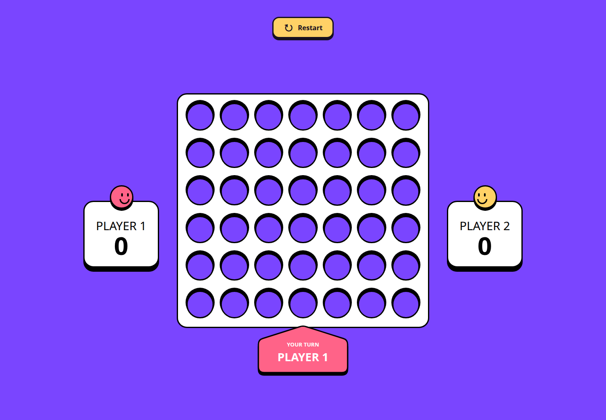
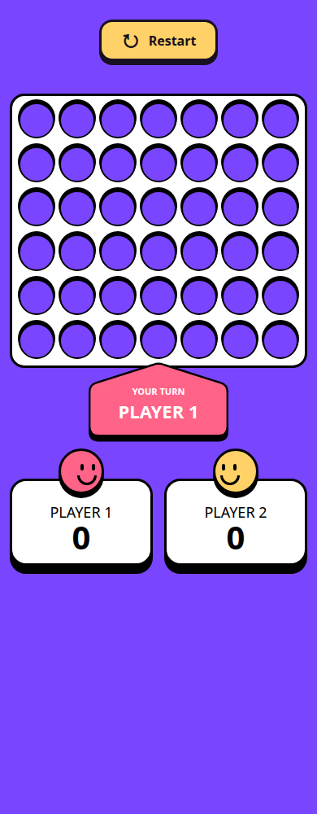

# Connect Four

Juego de cuatro en línea para dos personas en el mismo dispositivo, creado con HTML, CSS, JavaScript y Tailwind CSS. Incluye fichas con caras, animación de caída, marcador de victorias y diseño adaptable a móvil, tablet y escritorio.

## Capturas

### Escritorio

### Móvil

En pantallas pequeñas, el tablero aparece centrado y los marcadores se colocan debajo, en dos columnas.

## Cómo jugar

1. Abre el juego y espera a que termine la cuenta atrás inicial.
2. El **Player 1**, con fichas rojas, juega primero. El **Player 2** utiliza fichas amarillas.
3. Haz clic o toca una casilla de la columna donde quieras colocar tu ficha.
4. La ficha cae hasta la posición libre más baja de esa columna. Cuando termina de caer, cambia el turno.
5. Consulta la tarjeta **Your turn** debajo del tablero para saber a quién le toca.

En dispositivos con ratón, al señalar una casilla aparece un indicador encima de la columna con el color del turno actual.

## Reglas

- El tablero tiene **6 filas y 7 columnas**.
- Cada jugador coloca una ficha por turno.
- Las fichas se apilan desde abajo: no puedes elegir una fila concreta ni mover una ficha ya colocada.
- Si una columna está llena, la jugada no se realiza y conservas el turno.
- Mientras cae una ficha, no se pueden colocar otras.
- Gana quien conecte **cuatro o más fichas de su color**, en horizontal, vertical o cualquiera de las dos diagonales.
- Si el tablero se llena sin una línea ganadora, la ronda termina en empate y no se suman puntos.

## Victoria, puntos y nuevas rondas

Al ganar, se resalta la línea ganadora y se suma **un punto** al marcador del jugador. Un segundo después aparece el modal de victoria.

| Control | Acción |
| --- | --- |
| **View board** | Cierra el modal para ver la jugada ganadora. El tablero permanece bloqueado. |
| **Escape** | Cierra el modal de victoria. |
| **Next round** | Inicia otra ronda con el tablero vacío, conserva los puntos y repite la cuenta atrás. |
| **Restart** | Reinicia la partida: vacía el tablero, pone ambos marcadores a cero y repite la cuenta atrás. |

Cada nueva ronda comienza con Player 1. Si cierras el modal con **View board**, puedes volver a jugar pulsando **Restart**. En caso de empate, utiliza también **Restart**.

La puntuación se guarda únicamente durante la sesión de la página; al recargarla se pierde. El juego es local para dos personas: no incluye rival automático ni partidas en línea.
